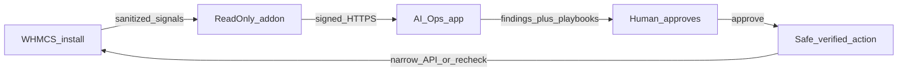

# Safe sellable product plan (WHMCS market)

Saved from product planning discussion so work can continue in a fresh chat without carrying this thread’s full context.

**Live domain context:** `ops.resellerbytes.com`  
**Related app:** ResellerBytes AI Operations (Forge + read-only WHMCS addon)

---

## Positioning — what we sell

**Do not sell:** “We replace WHMCS” or “AI will fix your WHMCS automatically.”

**Do sell:**

> WHMCS keeps running. We detect, prioritize, explain, and deliver **safe next actions** for its ops risk — with audit, multi-site history, and team workflow that WHMCS alone does not provide.

**One-liner:**  
**WHMCS Ops Copilot** — read-only diagnostics in → prioritized findings out → guided fixes + approved safe actions from one dashboard.

WHMCS capability is large; our wedge is what WHMCS does **not** productize:

- Cross-install ops intelligence
- Evidence-bound AI findings
- Closure tracking / digests / multi-tenant SaaS workflow
- “What should I fix first this week?” as a product answer

---

## Safety principle (non-negotiable)

1. **Collect** = read-only (current addon model).
2. **Recommend** = only from snapshot evidence.
3. **Act** = only allowlisted, reversible, audited actions — never free-form AI shell/SQL/API.
4. **Prove** = every action ends with re-run diagnostics and before/after evidence.

Architecture already states: AI output is advice only; no repair tools in release one. Expand that into a sellable journey — do not break it.

---

## What already exists (build on this)

- Read-only WHMCS addon → signed ingestion → AI analysis → findings (`WhmcsDiagnosticAnalyzer`)
- Soft-drop of unverifiable AI evidence paths (so analysis can complete without inventing evidence)
- Tenancy, plans/billing, platform mail/AI settings, Redis queue workers
- Explicit safety boundary: advice only; no WHMCS/20i/ResellerClub repair APIs for the model

---

## Phase 0 — Package current value as a product (1–2 weeks)

The analysis report works; make it **purchase-ready**.

- Finding page: severity, human-readable evidence, why it matters, WHMCS steps, change risk
- Deep links where possible
- Copy checklist · Mark resolved · Re-run diagnostics
- Healthy state that still sells: “Last scan clean”

**Sales:** 14-day pilot on 1 production WHMCS; one successful diagnostic cycle = win.

**Exit criteria:** An owner can explain in 30 seconds why this is not “ChatGPT + WHMCS.”

---

## Phase 1 — Guided Fix Center (first must-buy) ~3–6 weeks

Operators **decide here**; they click in WHMCS.

Per finding, a **Playbook card**:

| Block | Content |
|--------|---------|
| Detected | Issue + evidence |
| Impact | Risk if ignored |
| Safe steps | Numbered WHMCS/server steps |
| Verify | Re-check signal |
| Rollback | How to undo |

Also:

- Statuses: `open` → `in_progress` → `resolved` / `accepted_risk`
- Assignee (tenant member)
- Re-check + finding diff
- Weekly email digest (platform mail)

**Still no WHMCS write access.** Value = workflow + priority + accountability.

**Exit criteria:** Weekly ops run from this app; WHMCS is execution surface only.

---

## Phase 2 — Safe Actions (controlled automation) ~6–10 weeks

Only after Phase 1 trust. Each action requires:

- Plan entitlement flag
- Human Approve (2FA where risk warrants)
- Audit who/when/why
- Post-action automatic diagnostic

**Early candidates:**

- One-click remote diagnostic collect
- Read-only health/version ping
- Permissions audit report (read-only)
- Pre-filled WHMCS admin deep link with context (no secrets in URL)

**Do not automate in v1 of actions:**

- Editing `configuration.php` / disk permissions
- Blind module enable/disable
- DB / customer / invoice writes
- Anything the LLM invents at runtime (no free-form tools)

Architecture addition: code-defined `SafeAction` allowlist in Laravel; narrow WHMCS-side companion or official API scopes; same signed trust model as diagnostic ingestion.

**Exit criteria:** ≥3 allowlisted actions in production, zero severity-1 incidents; sales demo = Approve → Done → Verified.

---

## Phase 3 — WHMCS channel / GTM

1. Marketplace / partner listing: “Ops intelligence for WHMCS” (not “hosting panel”)
2. Hero demo: **multi-install** hosting dashboard (existing tenancy)
3. Sanitized before/after case studies
4. Objection handling:
   - “WHMCS already shows this” → we correlate, prioritize, and close across installs
   - “AI will break us” → read-only collect, allowlist, approve, audit
   - “Another script” → signed addon, no customer PII in snapshots, SLA

**Packaging suggestion:**

- **Starter:** 1 install, guided playbooks, email digest
- **Growth:** multi-install, assignees, re-check diffs
- **Agency:** staff access, higher AI budget, safe-actions pack

---

## Do not build (kills trust and sales)

- Autopilot that fixes WHMCS without approval
- Broad WHMCS API write from the LLM
- Collecting customer/invoice/payment data “for better AI”
- Replacing existing 20i / ResellerClub modules

---

## 90-day order

| Weeks | Focus |
|-------|--------|
| 1–2 | Phase 0 UX + landing + pilot script |
| 3–6 | Phase 1 Fix Center |
| 7–10 | First 1–2 safe actions |
| Ongoing | Listing + 3 pilot case studies |

**Metrics:** pilot→paid conversion, time-to-first-resolved-finding, weekly re-check usage, severity-1 from our actions = 0.

---

## Implementation status (in-app)

| Phase | Status | Notes |
|-------|--------|--------|
| Phase 0 | Done | Fix Center packaging, Last scan clean, checklist/copy, mark resolved |
| Phase 1 | Done | Playbooks, statuses, assignees, re-check diff, weekly digest |
| Phase 2 | Done | Allowlisted Safe Actions (≥4), entitlement, approve+audit+verify; no WHMCS writes |
| Phase 3 | Done (in-app GTM) | `/product`, `/case-studies`, packaging copy, objections on pricing, multi-install dashboard board |

**Still external / human:** WHMCS Marketplace listing submission, live pilot pricing confirmation, real customer case-study approvals.

## Immediate next build (new chat)

Start **Phase 0 / Phase 1 in-app**:

- Finding detail playbook layout
- Status workflow
- Re-check CTA

**No WHMCS write API yet.** Fastest path to a story WHMCS buyers will pay for.

*(Superseded — Phases 0–3 in-app work is implemented. Next: build + deploy + pilot.)*

---

## How to continue in a new chat

Open this file and ask, for example:

> Implement Phase 0/1 from `@docs/operations/safe-sellable-whmcs-product-plan.md` — finding playbook UI, statuses, mark resolved, re-check. No WHMCS write actions yet.
